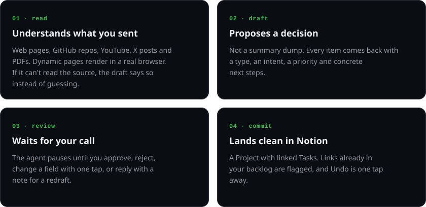
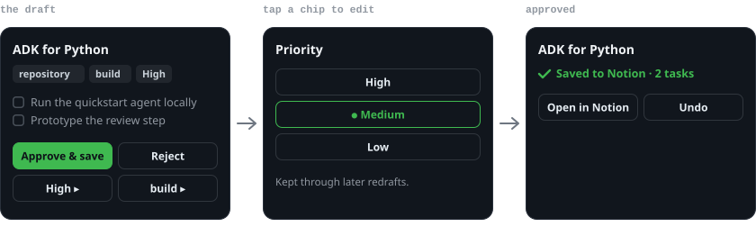
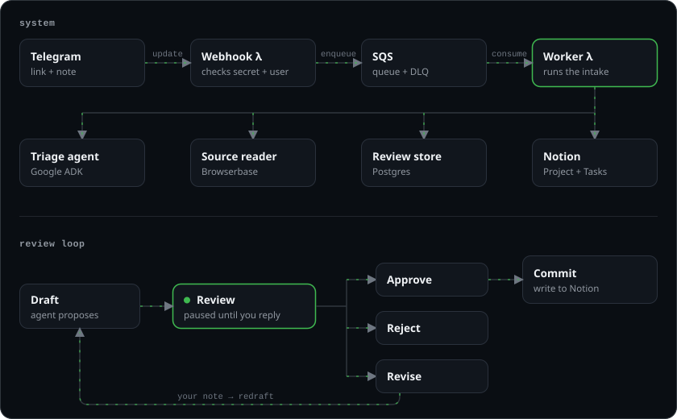

<p align="center">
  <picture>
    <source media="(prefers-color-scheme: dark)" srcset="docs/assets/header-dark.svg">
    
  </picture>
</p>

<p align="center">
  <a href="#what-it-does">what it does</a> &nbsp;/&nbsp;
  <a href="#review-in-one-tap">review</a> &nbsp;/&nbsp;
  <a href="#how-it-works">how it works</a> &nbsp;/&nbsp;
  <a href="#run-it">run it</a>
</p>

<p align="center">
  
</p>

<p align="center">
  <a href="https://github.com/iamtokarev/backlog-tamer/actions/workflows/ci.yml"></a>
  <a href="https://github.com/iamtokarev/backlog-tamer/releases"></a>
  
  
</p>

## What it does

<p align="center">
  
</p>

## Review in one tap

<p align="center">
  
</p>

Or just reply with a note, like *"this is for the eval project, not general reading"*, and get a redraft.

## How it works

<p align="center">
  
</p>

The review step is a Google ADK interrupt, not a chat turn, so free text can never be mistaken for approval.

## Run it

```sh
git clone https://github.com/iamtokarev/backlog-tamer && cd backlog-tamer
cp .env.example .env   # telegram, openrouter, browserbase, notion keys
make run
```

Configuration, Notion setup and AWS deploy: [docs/setup.md](docs/setup.md)
