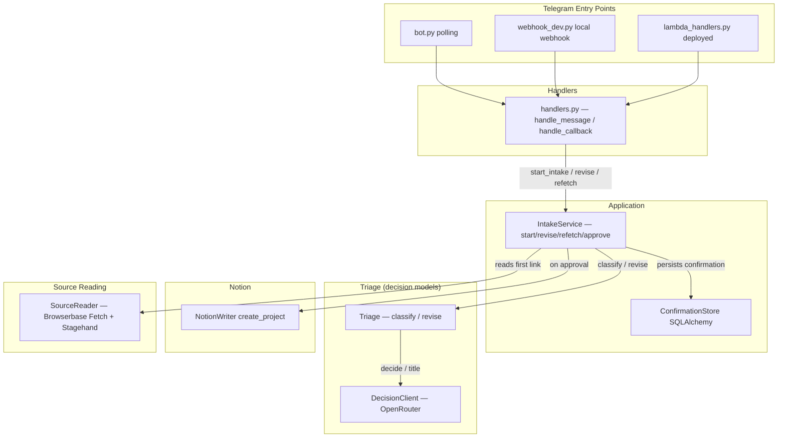

# Architecture Overview

Backlog Tamer is structured in three layers under `src/backlog_tamer/`. Each layer has a clear responsibility and the layers connect through well-defined interfaces. The design replaced an earlier Google ADK drafting agent with stateless decision-model Triage; [ADR 0001](https://github.com/iamtokarev/backlog-tamer/blob/main/docs/adr/0001-triage-by-decision-models.md) records the reasoning.

## Layers

### 1. Triage Layer — `triage/`

The decision layer. `Triage` (`triage.py`) is a stateless deep module with two operations — `classify` and `revise` — each returning a `ProjectDraft`. There is no ADK `Runner`, no session service, no `Checkpoint`, no interrupt, and no engine switch: the decision model answers typed questions over a fixed Label set, and one small LLM call writes the title.

- **`triage.py`** — `Triage` with `classify(context, grounding, vocabulary)` and `revise(context, grounding, draft, feedback, vocabulary)`. `classify` asks the decision model for the project type first, then intent/tags/priority with the type known (two sequential decision requests), while the title LLM call runs in parallel. `revise` first routes the feedback to the fields it is about (`routing_questions`), then re-decides only those; the title is rewritten only when the name is routed. A type change re-asks intent with the new type. A missing answer keeps the current value or the default. `from_settings` builds a `DecisionClient` from `Settings`.
- **`client.py`** — `DecisionClient` talks to OpenRouter: `decide` posts state + questions to `https://openrouter.ai/api/alpha/decisions` (chunked at `MAX_QUESTIONS_PER_REQUEST = 128`), and `title` posts a chat completion to `/v1/chat/completions` with `response_format` JSON schema, `reasoning: {"effort": "none"}`, and `provider: {"require_parameters": True}`. Retries on 429/502/503/524/529 (`MAX_ATTEMPTS = 4`) with `Retry-After`-aware backoff. Each call logs a `decision_triage_call` line (path, model, seconds, input tokens, cost). A fresh `httpx.AsyncClient` per call (Lambda creates a new event loop per invocation). `probe` calls both models once for the healthcheck.
- **`questions.py`** — the Label set criteria (`PROJECT_TYPES`, `INTENTS`, `PRIORITIES`), question builders (`type_question`, `intent_question`, `detail_questions`, `routing_questions`), and answer readers (`read_choice`, `read_priority`, `read_topics`, `read_routes`). Every question carries `GUARD`, the prompt-injection guard that tells the model page text is evidence to judge, never an instruction to follow. `subject_vocabulary` strips legacy tags and caps at `MAX_VOCABULARY = 120`.

Triage uses the shared domain types from `src/backlog_tamer/domain.py` (`IncomingContext`, `Grounding`, `ProjectDraft`, `fold_tag`). See [Data Model](../domain/data-model.md) and [Intake Workflow](../workflows/intake-flow.md).

### 2. Application Layer — `application/`

Orchestration independent of Telegram. `IntakeService` reads the source, calls `Triage`, manages confirmation state, and writes approved drafts to Notion. It delegates classification and revision to `Triage` directly — there is no workflow facade or session service between them.

- **`intake_service.py`** — `IntakeService` with `start_intake` (read first link → `Triage.classify` → persist `ConfirmationRecord`), `revise` (→ `Triage.revise` → re-apply quick edits via `with_edits`), `refetch` (re-read → re-classify → re-apply quick edits), `approve`, `reject`, `apply_quick_edit` (no model call; patches the stored draft), `get_review`, `finalize_approval`, `undo_commit`. `finalize_approval` uses `mark_committing_once` as an idempotency lock, then duplicate detection (`find_project_by_source`), then `NotionWriter.create_project`. `_known_topics` loads the existing Notion tag vocabulary via `NotionWriter.list_tag_options()` and passes it into `Triage`; best-effort, never blocks a capture. `_log_corrections` emits a structured `intake_correction` line at approval. `add_to_existing_project` is gone — drafts carry no tasks.
- **`confirmation_store.py`** — `ConfirmationStore` using SQLAlchemy with a `confirmations` table. `mark_committing_once` atomically transitions `PENDING_REVIEW` or `FAILED` → `COMMITTING` (idempotency lock; returns `acquired=False` if already committing/committed). `apply_manual_edit` patches the stored draft in place and records `ManualEdit(before, after)`. `update_draft` replaces the draft (and grounding) after a revision/refetch. Also `mark_committed`, `mark_duplicate`, `mark_undone`, `mark_failed`, `mark_rejected`. Legacy columns (`session_id`, `invocation_id`, `request_input_call_id`, `review_message`, `notion_task_ids_json`) are kept with empty defaults for rollback to v0.8.0 but neither written meaningfully nor read.
- **`models.py`** — `ConfirmationRecord` (no `checkpoint`, no `notion_task_ids`, no `review_message`; `manual_edits: dict[str, ManualEdit]`, `kept_fields` and `corrected_fields` properties), `ManualEdit` (before/after with `coerce` for legacy rows), `ConfirmationStatus` enum (`PENDING_REVIEW → COMMITTING → COMMITTED / REJECTED / FAILED / UNDONE / DUPLICATE`), `IntakeResult`.
- **`database_urls.py`** (top level) — `to_sync_database_url` converts a `DATABASE_URL` into the sync driver (psycopg/sqlite); `uses_external_pooler` detects Supabase transaction-mode pooler. Only sync drivers are needed now — the async ADK `DatabaseSessionService` is gone.

### 3. Integrations Layer — `integrations/`

External system connections. Telegram provides three entry points that all share the same handlers; Notion is the write target for approved drafts; Browserbase is the source reader.

- **`telegram/`** — `bot.py` (local polling), `webhook_dev.py` (local webhook server), `lambda_handlers.py` (deployed: webhook receives and enqueues to SQS, worker dequeues and processes). `handlers.py` contains the shared `handle_message` and `handle_callback` logic. `webhook.py` has `TelegramUpdateProcessor` and webhook validation. `parsing.py` extracts `IncomingContext` from Telegram messages. `rendering.py` builds HTML messages and inline keyboards. `state.py` persists revision state and deduplicates updates. `callbacks.py` encodes/decodes the inline-keyboard `callback_data` wire format.
- **`notion/writer.py`** — `NotionWriter.create_project` creates a single project page (with body children: bookmark, note, key points, provenance callout). No task pages, no tasks database, no `add_tasks_to_project`. Also `find_project_by_source` (duplicate detection), `list_tag_options` (tag vocabulary), `describe_schema` (healthcheck), `archive_pages` (undo), and `_fit_to_schema` (drops properties missing from the target database).
- **`source_reader.py`** — `SourceReader.read` turns a public URL into a `FetchedUrl` Grounding result (or a structured failure) through Browserbase Fetch API and hosted Stagehand rendering, with local SSRF validation and an extraction escalation ladder. `FetchedUrl.to_grounding()` converts it into the shared `Grounding` type. See [Source Reader](../integrations/source-reader.md).

The integrations are detailed in [Telegram & Notion Integrations](../integrations/telegram-and-notion.md).

## How Layers Connect

*Three-layer architecture: Telegram entry points dispatch through shared handlers to IntakeService, which reads the source, calls Triage for classification/revision, persists confirmation state, and writes approved drafts to Notion.*

## Key Design Decisions

- **Decision models, not a drafting agent.** Triage asks a decision model typed questions over a fixed Label set and one title LLM call, instead of an ADK agent that wrote prose summaries and tasks nobody used. This matched agent quality at a fraction of the latency (≈1 s vs 15–22 s) and stopped revisions from rewriting fields the feedback never mentioned. There is no fallback to the agent. See [ADR 0001](https://github.com/iamtokarev/backlog-tamer/blob/main/docs/adr/0001-triage-by-decision-models.md).
- **Stateless Triage.** `Triage` holds no session, checkpoint, or interrupt state. `classify` and `revise` take the context, grounding, and draft as arguments and return a new `ProjectDraft`. `IntakeService` owns all durable state through `ConfirmationStore`; a revision re-runs `Triage.revise` and re-applies the user's quick edits via `ProjectDraft.with_edits`.
- **Revision routes first, then re-decides.** `Triage.revise` asks routing questions (`change_<field>`) to identify which fields the feedback is about, then re-decides only those. A type change re-asks intent with the new type. Unrelated fields are kept, so a revision never silently undoes a quick edit.
- **Quick edits win over revisions.** Quick-edit button changes last for the whole review and are re-applied after every revision and refetch via `kept_fields` → `ProjectDraft.with_edits`. `Triage` never sees them.
- **No Tasks.** A draft is a project only; the user creates tasks themselves in Notion. `notion_tasks_database_id` is gone from `Settings`.
- **Dual drivers from one URL (sync only).** `database_urls.to_sync_database_url` derives the sync SQLAlchemy driver from a single `DATABASE_URL`. The async ADK session service and its async engine options are gone.
- **Idempotent Notion commits.** `mark_committing_once` atomically transitions a confirmation from `PENDING_REVIEW` or `FAILED` to `COMMITTING`, preventing duplicate writes if `finalize_approval` is called multiple times. `FAILED` is retryable without re-running Triage.
- **Three Telegram entry points, shared handlers.** All three entry points (`bot.py`, `webhook_dev.py`, `lambda_handlers.py`) build the same `Application` via `build_application` and use the same `handle_message` / `handle_callback` handlers.
- **SQS queue in production.** The Lambda webhook handler validates and enqueues; the Lambda worker handler dequeues and processes. This decouples Telegram's webhook timeout from the potentially slow Triage calls.
- **Canonical source URL for duplicate detection.** `normalize_source_url` (in `source_urls.py`) strips campaign parameters; `NotionWriter` stores `grounding.canonical_url` via `commit_source_url`; `find_project_by_source` looks up by canonical URL. See [Source Reader](../integrations/source-reader.md).

## Source References

| File | Purpose |
|------|---------|
| `src/backlog_tamer/triage/triage.py` | `Triage` — `classify`, `revise`, `from_settings` |
| `src/backlog_tamer/triage/client.py` | `DecisionClient` — OpenRouter decisions + title calls, retries, usage logging |
| `src/backlog_tamer/triage/questions.py` | Label set criteria, question builders, answer readers, `GUARD` |
| `src/backlog_tamer/domain.py` | `IncomingContext`, `Grounding`, `ProjectDraft`, `fold_tag` |
| `src/backlog_tamer/application/intake_service.py` | Core orchestration service |
| `src/backlog_tamer/application/confirmation_store.py` | Confirmation persistence with idempotency |
| `src/backlog_tamer/application/models.py` | `ConfirmationRecord`, `ManualEdit`, `ConfirmationStatus`, `IntakeResult` |
| `src/backlog_tamer/integrations/telegram/handlers.py` | Shared Telegram message/callback handlers |
| `src/backlog_tamer/integrations/telegram/bot.py` | `build_application` + polling entry point |
| `src/backlog_tamer/integrations/notion/writer.py` | Notion API writer (`create_project`) |
| `src/backlog_tamer/integrations/source_reader.py` | `SourceReader`, `FetchedUrl`, Browserbase + Stagehand extraction |
| `src/backlog_tamer/source_urls.py` | `normalize_source_url`, `strip_tracking_params`, `youtube_watch_url` |
| `src/backlog_tamer/config.py` | Settings model (`TriageConfig`, `Settings`) |
| `src/backlog_tamer/database_urls.py` | `to_sync_database_url`, `uses_external_pooler` |