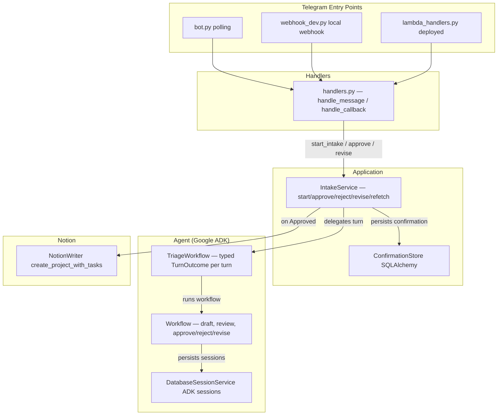

# Architecture Overview

Backlog Tamer is structured in three layers under `src/backlog_tamer/`. Each layer has a clear responsibility and the layers connect through well-defined interfaces.

## Layers

### 1. Agent Layer — `agents/intake_triage/`

The AI triage layer. A Google ADK `Agent` wraps an OpenRouter model through ADK's `LiteLlm` adapter and produces a structured `ProjectDraft` as output. The agent is embedded in a `Workflow` graph that implements the human-in-the-loop approval cycle using ADK interrupts. A facade class, `TriageWorkflow`, wraps the ADK `Runner` and session service and exposes typed `TurnOutcome` results (`NeedsReview`, `Approved`, `Rejected`) so the application layer never touches ADK internals directly.

- **`agent.py`** — defines `draft_agent` (the LLM agent) and `root_agent` (the workflow wrapping the agent). The agent uses `output_schema=ProjectDraft` and `output_key="draft_proposal"` to write structured drafts into session state. `_get_model` builds the `LiteLlm` adapter with `model=f"openrouter/{config.model}"`, `api_base="https://openrouter.ai/api/v1"`, and the OpenRouter key from `Settings`, and passes native `reasoning.effort` plus `provider.require_parameters=true` via `extra_body` (see Key Design Decisions below).
- **`triage_workflow.py`** — `TriageWorkflow`, the agent-layer facade that owns the ADK `Runner` and `DatabaseSessionService`. Its methods (`start`, `revise`, `refetch`, `approve`, `reject`) each run one ADK turn and return a `TurnOutcome`: `NeedsReview` (draft + `Checkpoint` + grounding + review message), `Approved`, or `Rejected` (with the draft for the review card). `from_settings` lazily imports the agent module so the LLM client is only built when a workflow is actually constructed. The opaque `Checkpoint` dataclass bundles the `session_id`, `invocation_id`, and `request_input_call_id` needed to resume a paused turn.
- **`workflow.py`** — builds the ADK `Workflow` graph: `draft → request_human_review → handle_human_review → {approved, rejected, revise}`. The `request_human_review` node emits a `RequestInput` interrupt that pauses execution until the user responds. `build_triage_message`/`build_triage_state_delta` thread the workspace's existing Notion tag vocabulary (`known_topics`) into the drafting prompt.
- **`prompts.py`** — system instructions, triage prompt templates (with the compact `project_type` vocabulary and the existing-tags hint), review message templates, revision prompt builder, `REFETCH_FEEDBACK` (the instruction sent on a refetch turn), and `build_revision_feedback` (prepends the user's quick-edit `kept_fields` so a revision does not silently undo them).
- **`schemas.py`** — Pydantic models: `IncomingContext`, `ProjectDraft` (with `short_name`, `effective_short_name`, `project_type`, and the `migrate_legacy_resource_type` validator), `FetchedUrl`, `DraftGrounding` (fetch results summary with `is_degraded` property), `SourceLink`, `ReviewDecision`.
- **`task_names.py`** — composes the default task name as `"<verb>: <short_name>"` deterministically from intent/project type, instead of asking the model to name it each run.
- **`tools/fetch_url.py`** — a tool the agent can call to fetch and extract context from web URLs, with SSRF protection, support for HTML, PDF, and X/Twitter oEmbed, YouTube watch-URL normalization, campaign-parameter stripping (for canonical duplicate detection), and page-furniture filtering out of key points.

The agent layer is detailed further in [Intake Workflow](../workflows/intake-flow.md).

### 2. Application Layer — `application/`

Orchestration independent of Telegram. `IntakeService` runs the triage workflow, manages confirmation state, and writes approved drafts to Notion. It delegates each ADK turn to `TriageWorkflow` and dispatches the resulting `TurnOutcome` — it no longer reads ADK event streams or session state directly.

- **`intake_service.py`** — `IntakeService` with methods `start_intake`, `approve`, `reject`, `revise`, `refetch` (each delegates a turn to `TriageWorkflow`), `apply_quick_edit` (no agent re-run), `get_review`, `finalize_approval`, `undo_commit`, and `add_to_existing_project`. The internal `_resume` pattern-matches the `TurnOutcome`: `NeedsReview` updates the stored draft/checkpoint and returns the review card, `Approved` calls `finalize_approval` (duplicate detection then Notion write), `Rejected` marks the confirmation rejected. `start_intake` loads the existing Notion tag vocabulary via `_known_topics` → `NotionWriter.list_tag_options()` and passes it into the workflow. `_log_corrections` emits a structured `intake_correction` line at approval so quick-edit corrections remain measurable.
- **`confirmation_store.py`** — `ConfirmationStore` using SQLAlchemy with a `confirmations` table. Provides `mark_committing_once` as an idempotency lock to prevent duplicate Notion writes (also accepts `FAILED` for retry). Supports `apply_manual_edit` for quick-edit button changes (records `ManualEdit(before, after)` pairs, normalizes legacy `resource_type` to `project_type`), `update_after_resume` (writes the new draft and `Checkpoint` after a revision turn), `mark_duplicate`, `mark_undone`, and `mark_committed` with task IDs. The store maps `ConfirmationRecord.checkpoint` onto the existing `session_id`/`invocation_id`/`request_input_call_id` columns.
- **`models.py`** — `ConfirmationRecord` (with `checkpoint: Checkpoint`, `grounding`, `manual_edits: dict[str, ManualEdit]`, `notion_task_ids`; `corrected_fields` and `kept_fields` properties), `ManualEdit` (before/after pair with `coerce` for legacy rows), `ConfirmationStatus` (enum: `PENDING_REVIEW → COMMITTING → COMMITTED / REJECTED / FAILED / UNDONE / DUPLICATE`), `IntakeResult` (with `grounding`, `duplicate_created_time`, `failure_reason` fields).
- **`database_urls.py`** — converts a single `DATABASE_URL` into the sync driver (psycopg/sqlite) for `ConfirmationStore` and the async driver (asyncpg/aiosqlite) for ADK `DatabaseSessionService`. Also provides `uses_external_pooler` and `async_engine_options` for Supabase transaction-pooler compatibility (disables asyncpg statement caching and uses `NullPool`).

### 3. Integrations Layer — `integrations/`

External system connections. Telegram provides three entry points that all share the same handlers; Notion is the write target for approved drafts.

- **`telegram/`** — `bot.py` (local polling), `webhook_dev.py` (local webhook server), `lambda_handlers.py` (deployed: webhook receives and enqueues to SQS, worker dequeues and processes). `handlers.py` contains the shared `handle_message` and `handle_callback` logic, handling approve/reject/revise plus quick edits, refetch, retry, undo, and add-task-to-duplicate. `webhook.py` has `TelegramUpdateProcessor` and webhook validation. `parsing.py` extracts `IncomingContext` from Telegram messages. `rendering.py` builds HTML messages, inline keyboards (review, picker, terminal), and change summaries. `state.py` persists revision state and deduplicates updates, using `NullPool` for external poolers.
- **`notion/writer.py`** — `NotionWriter` creates project pages (with page-body children: bookmark, note, key points, to-do tasks, provenance callout) and task pages in Notion databases. Also performs duplicate detection (`find_project_by_source`), tag vocabulary lookup (`list_tag_options`, fed into the drafting prompt), schema fitting (`_fit_to_schema` drops properties missing from the target database, and renames `Project type` to legacy `Type` when needed; property definitions cached in `_schema_cache`), canonical source URL selection (`commit_source_url`), undo (`archive_pages`), and schema health reporting (`describe_schema` for the healthcheck, including `degraded_capabilities` for gaps that disable a feature). Sets page icons from project type, due dates from priority, and topic-based tags folded onto existing tag spellings.

The integrations are detailed in [Telegram & Notion Integrations](../integrations/telegram-and-notion.md).

## How Layers Connect

*Three-layer architecture: Telegram entry points dispatch through shared handlers to IntakeService, which delegates each turn to TriageWorkflow and writes approved drafts to Notion.*

## Key Design Decisions

- **Human-in-the-loop via ADK interrupts, not chat turns.** The workflow pauses at `request_human_review` by emitting a `RequestInput` interrupt. `TriageWorkflow` extracts the interrupt from the event stream, wraps the resume coordinates in an opaque `Checkpoint`, and returns a `NeedsReview` outcome. A later call (`approve`, `reject`, `revise`, or `refetch`) resumes the paused turn through the `Checkpoint`, and `TriageWorkflow` maps the outcome to `Approved` or `Rejected`. `IntakeService` only ever sees typed outcomes — it never inspects ADK events.
- **TriageWorkflow as the ADK boundary.** `TriageWorkflow` (`triage_workflow.py`) is the only component that imports `Runner`, `DatabaseSessionService`, or event-stream parsing. This lets `IntakeService` depend on a simple protocol (`start`/`revise`/`refetch`/`approve`/`reject` → `TurnOutcome`) and makes the intake flow testable with a `ScriptedTriageWorkflow` that queues outcomes without running ADK (`tests/test_intake_flow.py`).
- **Dual database drivers from one URL.** `database_urls.py` derives both sync (for `ConfirmationStore`) and async (for ADK `DatabaseSessionService`) connection strings from a single `DATABASE_URL`, supporting SQLite locally and Postgres/Supabase in production.
- **Idempotent Notion commits.** `mark_committing_once` atomically transitions a confirmation from `PENDING_REVIEW` to `COMMITTING`, preventing duplicate writes if `finalize_approval` is called multiple times.
- **Three Telegram entry points, shared handlers.** All three entry points (`bot.py`, `webhook_dev.py`, `lambda_handlers.py`) build the same `Application` via `build_application` and use the same `handle_message` / `handle_callback` handlers.
- **SQS queue in production.** The Lambda webhook handler validates and enqueues; the Lambda worker handler dequeues and processes. This decouples Telegram's webhook timeout from the potentially slow agent workflow.
- **OpenRouter via ADK `LiteLlm`, with native reasoning parameters.** The agent talks to OpenRouter exclusively through ADK's `LiteLlm` adapter (`agent.py::_get_model`), using `api_base="https://openrouter.ai/api/v1"` and the root `OPENROUTER_API_KEY` from `Settings` — direct OpenAI credentials and endpoints are no longer used. `AGENT__MODEL` is an OpenRouter slug including its publisher (default `openai/gpt-6-luna`; the adapter adds the `openrouter/` transport prefix), so a different publisher can be selected by changing one setting (e.g. `anthropic/claude-sonnet-5`). The adapter sends native `reasoning.effort` (from `AgentConfig`, default `"medium"`, settable via `AGENT__REASONING_EFFORT` with options `none`, `low`, `medium`, `high`) and `provider.require_parameters=true` through `extra_body` rather than relying on LiteLLM's model-metadata parameter whitelist. Explicit `reasoning.effort` preserves the configured medium effort by sending OpenRouter's native reasoning object, so the value is forwarded instead of being dropped silently through LiteLLM's parameter whitelist; `provider.require_parameters=true` selects endpoints that support the requested parameters (capability-aware routing, as OpenRouter's structured-output guidance recommends). The request shape — OpenRouter URL, bearer key, model slug, `reasoning`/`provider` body, publisher override, and auth-error propagation without fallback — is pinned by `tests/test_agent_model.py`.
- **Classification as a correction signal, not a taxonomy.** A week of traces showed 7/7 approvals with zero revisions while classification was wrong: the review signal and the taxonomy had both stopped carrying information. The response (commit `e5ca04f`) expanded `project_type` with `article`, `video`, and `course`; composed the default task name deterministically in code (`task_names.py`) instead of leaving it to the prompt; replaced the "default to Medium" priority escape hatch with a rubric; fed the existing tag vocabulary into the prompt; stored the canonical source URL so duplicate detection could match; and recorded what the agent proposed beside what the user picked (`ManualEdit.before/after`, logged at approval) so quick-edit corrections became a measurable per-field accuracy signal.
- **Canonical source URL for duplicate detection.** `fetch_url` strips campaign parameters (`utm_*`, `fbclid`, `gclid`, …) from the normalized URL, `NotionWriter` stores `grounding.canonical_url` via `commit_source_url`, and `find_project_by_source` looks up by canonical URL — so a re-capture of the same page through a different tracking link matches its earlier row instead of creating a duplicate. YouTube links are normalized to a single watch URL (`youtube_watch_url`) so `youtu.be`, `/shorts/`, `/live/`, `/embed/`, and `/v/` variants all resolve to `https://www.youtube.com/watch?v={id}`; the page's own JS-templated `<link rel="canonical">` can render as `youtube.com/undefined` to datacenter IPs, so the watch URL derived from the link is pinned instead.

## Source References

| File | Purpose |
|------|---------|
| `src/backlog_tamer/agents/intake_triage/agent.py` | Agent and workflow assembly |
| `src/backlog_tamer/agents/intake_triage/triage_workflow.py` | `TriageWorkflow` — ADK facade, `Checkpoint`, `TurnOutcome` types |
| `src/backlog_tamer/agents/intake_triage/workflow.py` | ADK workflow graph definition |
| `src/backlog_tamer/agents/intake_triage/prompts.py` | Prompt templates; existing-tags hint (`MAX_KNOWN_TOPICS`); `REFETCH_FEEDBACK`, `build_revision_feedback` |
| `src/backlog_tamer/agents/intake_triage/task_names.py` | Deterministic default task name composition |
| `src/backlog_tamer/application/intake_service.py` | Core orchestration service |
| `src/backlog_tamer/application/confirmation_store.py` | Confirmation persistence with idempotency |
| `src/backlog_tamer/application/models.py` | `ConfirmationRecord`, `ManualEdit`, `ConfirmationStatus` |
| `src/backlog_tamer/integrations/telegram/handlers.py` | Shared Telegram message/callback handlers |
| `src/backlog_tamer/integrations/telegram/bot.py` | `build_application` + polling entry point |
| `src/backlog_tamer/integrations/notion/writer.py` | Notion API writer |
| `scripts/migrate_notion_schema.py` | One-time Notion schema migration |
| `src/backlog_tamer/config.py` | Settings model (pydantic-settings) |
