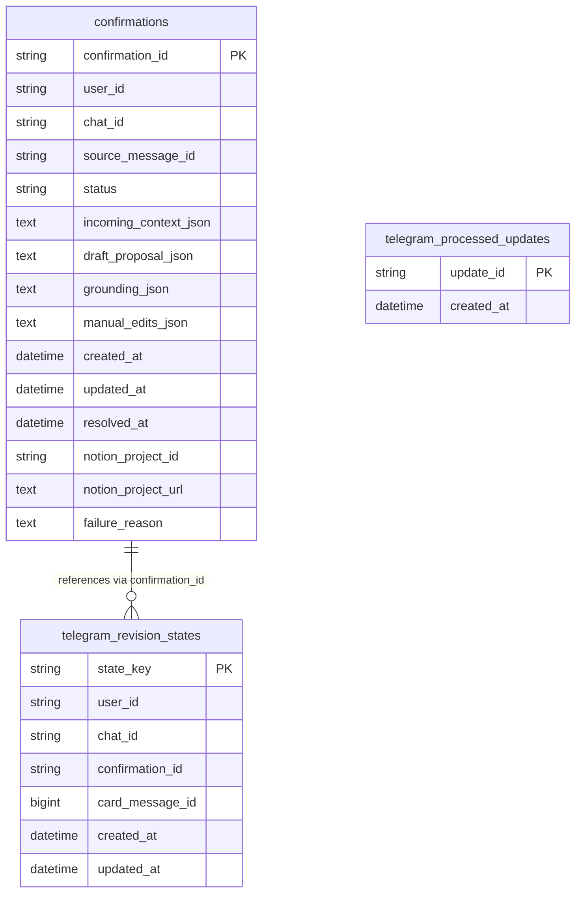

# Data Model

Backlog Tamer uses Pydantic models for domain data and internal transfer, SQLAlchemy tables for durable state, and Notion API payloads for external writes.

## Domain Types

Defined in `src/backlog_tamer/domain.py`. These are the shared types used by [Triage](../workflows/intake-flow.md), the application layer, and the integrations.

### IncomingContext

The parsed user input from a Telegram message. Built by `parsing.py` from Telegram `Message` entities.

| Field | Type | Notes |
|-------|------|-------|
| `raw_text` | `str` | Full message text or caption, min length 1 |
| `note` | `str \| None` | Text with URLs stripped out |
| `links` | `list[SourceLink]` | Deduplicated URLs from message entities and text links |

### SourceLink

| Field | Type | Notes |
|-------|------|-------|
| `url` | `HttpUrl` | A URL from the message |

### Grounding

What was actually read from the source behind a draft, kept beside it so the review card can show confidence, the Notion page can carry key points, and a revision can judge the page without a refetch. Replaces the earlier `DraftGrounding`.

| Field | Type | Notes |
|-------|------|-------|
| `fetch_status` | `Literal["success", "error", "skipped"]` | Defaults to `"skipped"` |
| `fetch_error` | `str \| None` | Error reason if fetch failed |
| `site_name` | `str \| None` | From fetched page metadata |
| `page_title` | `str \| None` | From fetched page |
| `canonical_url` | `str \| None` | Used for duplicate detection |
| `final_url` | `str \| None` | After redirects |
| `description` | `str \| None` | From fetched page metadata |
| `author` | `str \| None` | |
| `published_at` | `str \| None` | |
| `domain` | `str \| None` | |
| `page_kind` | `str \| None` | `html`, `pdf`, `text`, `unknown` |
| `key_points` | `list[str]` | Up to 4, surfaced in the Notion page body |
| `content_preview` | `str \| None` | |

The `is_degraded` property returns `True` when `fetch_status == "error"`, which triggers a fetch-warning footer on the review card and a "Retry fetch" button.

### ProjectDraft

The structured draft produced by `Triage.classify` / `Triage.revise`. No `short_name`, no `tasks`, no `migrate_legacy_resource_type` validator — the task name composition and legacy `resource_type` migration from the agent era are gone.

| Field | Type | Notes |
|-------|------|-------|
| `project_name` | `str` | Min length 1; written by the title LLM call |
| `summary` | `str` | 1–600 chars; the page description or title, not model-written |
| `project_type` | `Literal` | `paper`, `article`, `video`, `course`, `repository`, `product`, `company`, `model`, `tool` |
| `intent` | `Literal` | `learn`, `build`, `research`, `explore`, `reference`, `unclear` |
| `priority` | `Literal` | `Low`, `Medium`, `High` — defaults to `Medium` unless a note or revision speaks to it |
| `source_url` | `str \| None` | Prefers `grounding.canonical_url` |
| `topics` | `list[str]` | Up to 3 subject tags |

`with_edits(fields)` returns a new `ProjectDraft` with `fields` applied and re-validated, used by `IntakeService` to re-apply quick edits after a revision or refetch.

### fold_tag

`fold_tag(tag)` collapses spelling differences that should not count as a second tag: lowercases, splits on non-alphanumerics, and strips trailing plurals from words longer than 3 chars. Used by `read_topics` (so `llm-agents` matches `llm agent` when deduplicating picked tags) and by the eval's tag comparison.

## FetchedUrl

Result of `SourceReader.read`, defined in `src/backlog_tamer/integrations/source_reader.py`. `FetchedUrl.to_grounding()` converts it into the shared `Grounding` type. See [Source Reader](../integrations/source-reader.md).

| Field | Type | Notes |
|-------|------|-------|
| `status` | `Literal["success", "error"]` | |
| `requested_url` | `str` | Normalized URL passed in |
| `final_url` | `str \| None` | After redirects |
| `canonical_url` | `str \| None` | From `<link rel="canonical">`, or the pinned YouTube watch URL |
| `domain`, `page_kind`, `content_type`, `status_code` | various | `page_kind`: `html`, `pdf`, `text`, `unknown` |
| `title`, `description`, `site_name`, `author`, `published_at` | `str \| None` | Extracted metadata |
| `key_points` | `list[str]` | Up to 5 |
| `content_preview` | `str \| None` | Max 1600 chars |
| `notes` | `list[str]` | e.g. `"Only the first 5 PDF pages were parsed."` |
| `error` | `str \| None` | Structured failure reason |

## Application Models

Defined in `src/backlog_tamer/application/models.py`.

### ConfirmationStatus

```python
class ConfirmationStatus(StrEnum):
    PENDING_REVIEW = "pending_review"
    COMMITTING = "committing"
    COMMITTED = "committed"
    REJECTED = "rejected"
    FAILED = "failed"
    UNDONE = "undone"
    DUPLICATE = "duplicate"
```

`FAILED` is retryable — `mark_committing_once` accepts `FAILED` as a valid source state. `UNDONE` means the Notion page was archived after a commit (via the undo button). `DUPLICATE` means a project with the same source URL already exists.

### ManualEdit

One field the user corrected with the inline-keyboard quick-edit buttons, paired with what Triage originally proposed.

| Field | Type | Notes |
|-------|------|-------|
| `before` | `str` | Triage's original answer; kept stable across repeated taps (only set the first time) |
| `after` | `str` | The user's corrected value |

`ManualEdit.coerce` loads rows written before `before` existed (a bare `str` becomes `ManualEdit(after=value)`). A `field_validator` on `ConfirmationRecord.manual_edits` runs `coerce` on every entry.

`corrected_fields` returns only edits where `before` is non-empty and differs from `after` — the per-field accuracy signal that `IntakeService._log_corrections` emits as one structured `intake_correction` line at approval.

### ConfirmationRecord

The full state of an intake item, persisted in the `confirmations` table. No `checkpoint`, no `notion_task_ids`, no `review_message` — those ADK-era fields are gone from the model (legacy columns remain in the table for rollback to v0.8.0).

| Field | Type | Notes |
|-------|------|-------|
| `confirmation_id` | `str` | UUID, primary key |
| `user_id` | `str` | Telegram user ID |
| `chat_id` | `str \| None` | Telegram chat ID |
| `source_message_id` | `str \| None` | Telegram message ID |
| `status` | `ConfirmationStatus` | Current lifecycle state |
| `incoming_context` | `IncomingContext` | Original user input |
| `draft_proposal` | `ProjectDraft` | Latest draft |
| `grounding` | `Grounding` | What the source reader learned |
| `manual_edits` | `dict[str, ManualEdit]` | Quick edits as before/after pairs; replayed after every revision/refetch |
| `created_at`, `updated_at` | `datetime` | Timestamps |
| `resolved_at` | `datetime \| None` | Set when terminal |
| `notion_project_id` | `str \| None` | Notion page ID after commit |
| `notion_project_url` | `str \| None` | Notion page URL after commit |
| `failure_reason` | `str \| None` | Error details if FAILED |

`kept_fields` returns `{field: edit.after}` for all manual edits — the quick edits the next revision must preserve.

### IntakeResult

The return type from `IntakeService` methods, consumed by Telegram handlers.

| Field | Type | Notes |
|-------|------|-------|
| `status` | `str` | Lifecycle status string |
| `confirmation_id` | `str \| None` | |
| `draft_proposal` | `ProjectDraft \| None` | |
| `grounding` | `Grounding` | Fetch results summary |
| `notion_project_url` | `str \| None` | |
| `duplicate_created_time` | `str \| None` | When the existing duplicate was created |
| `failure_reason` | `str \| None` | Error details if FAILED |

## Database Tables

### `confirmations` (ConfirmationStore)

Defined in `src/backlog_tamer/application/confirmation_store.py`. Uses SQLAlchemy ORM. JSON fields store `IncomingContext`, `ProjectDraft`, `Grounding`, and `manual_edits` as serialized strings. Legacy columns (`session_id`, `invocation_id`, `request_input_call_id`, `review_message`, `notion_task_ids_json`) are kept with empty defaults for rollback to v0.8.0 but are neither written meaningfully nor read.

### `telegram_revision_states` (TelegramStateStore)

Defined in `src/backlog_tamer/integrations/telegram/state.py`. Tracks which confirmation a user is currently revising per chat.

| Column | Type | Notes |
|--------|------|-------|
| `state_key` | `String(255)` | PK, composite of user_id + chat_id |
| `user_id` | `String(255)` | |
| `chat_id` | `String(255)` | |
| `confirmation_id` | `String(64)` | Which draft is being revised |
| `card_message_id` | `BigInteger \| None` | The review card whose keyboard became "Cancel revision" |
| `created_at`, `updated_at` | `DateTime` | |

### `telegram_processed_updates` (TelegramStateStore)

Deduplication table for Lambda worker. Prevents processing the same Telegram update twice if SQS delivers duplicates.

| Column | Type | Notes |
|--------|------|-------|
| `update_id` | `String(64)` | PK, Telegram update_id |
| `created_at` | `DateTime` | |

## Entity Relationships



## Notion Payload Structure

`NotionWriter` (`src/backlog_tamer/integrations/notion/writer.py`) builds a single project page payload. There are no task pages — drafts carry no tasks.

### Project Page

Created in the projects database via `create_project`:

- **Project name** (title): `draft.project_name`
- **Status** (status): `"Backlog"` (fixed default)
- **Priority** (select): `draft.priority`
- **Project type** (select): `draft.project_type` (property name `"Project type"`; falls back to legacy `"Type"` if that is the only column the database has)
- **Intent** (select): `draft.intent`
- **Tags** (multi_select): `draft.topics`, folded onto existing tag spellings via `fold_tag`/`_tag_key`
- **Captured** (date): today's date
- **Summary** (rich_text): `draft.summary`
- **Source** (url): `commit_source_url(draft, grounding)` — prefers `grounding.canonical_url` for duplicate detection
- **Icon**: emoji mapped from `project_type`
- **Children** (page body): bookmark block for the source URL, "Why I saved this" heading with the user's note, "Key points" from grounding, and a provenance callout. No `template` is sent (Notion rejects a page with both a template and children).
- Optional properties (Source, Project type or legacy Type, Intent, Captured) are silently dropped if the database does not have them, via `_fit_to_schema`.

## Source References

| File | Purpose |
|------|---------|
| `src/backlog_tamer/domain.py` | `IncomingContext`, `SourceLink`, `Grounding`, `ProjectDraft` (`with_edits`), `fold_tag` |
| `src/backlog_tamer/integrations/source_reader.py` | `FetchedUrl` (`to_grounding`), `_PageGrounding` extraction schema |
| `src/backlog_tamer/application/models.py` | `ConfirmationRecord`, `ConfirmationStatus`, `ManualEdit`, `IntakeResult` |
| `src/backlog_tamer/application/confirmation_store.py` | `ConfirmationRow` ORM, `confirmations` table |
| `src/backlog_tamer/integrations/telegram/state.py` | `TelegramRevisionRow`, `TelegramUpdateRow` ORM |
| `src/backlog_tamer/integrations/notion/writer.py` | Notion project page payload builder, `commit_source_url` |