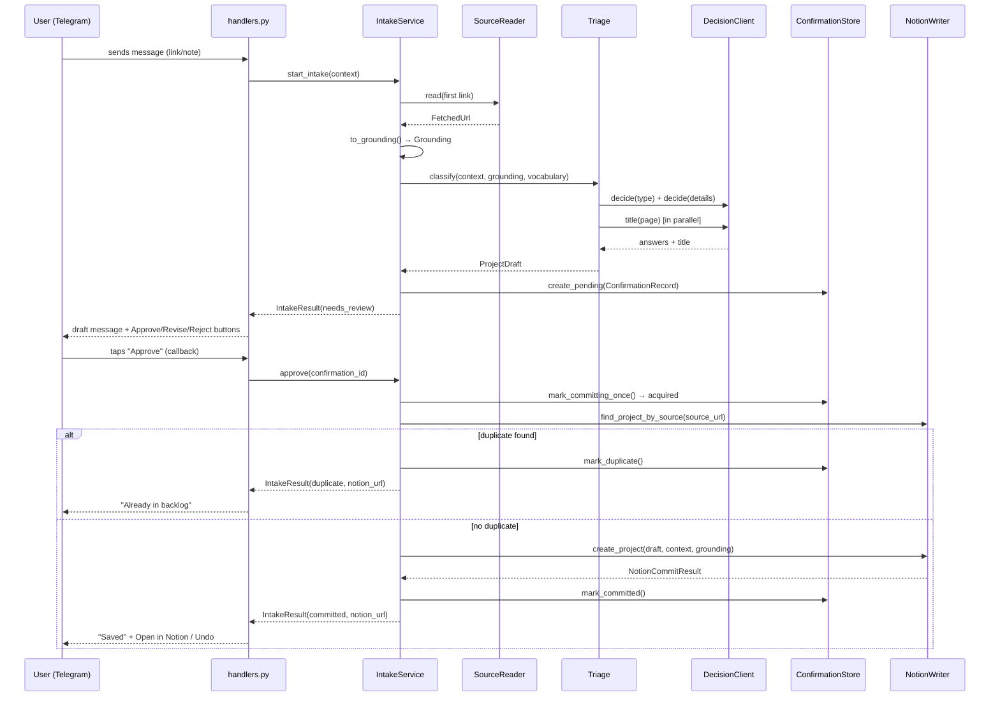
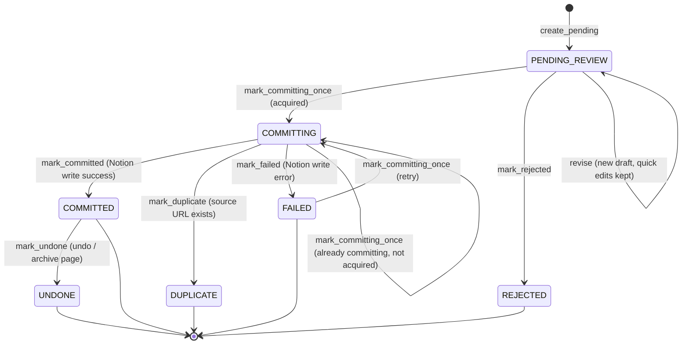

# Intake Workflow

The intake workflow is the core product loop. It takes a raw Telegram message, reads the first link, runs it through `Triage` (decision models that produce a structured draft), pauses for human review, and either commits the draft to Notion, rejects it, or loops back for revision.

The flow is split across two components: `Triage` (`triage/triage.py`) is a stateless deep module that classifies and revises; `IntakeService` (`application/intake_service.py`) drives Triage, persists confirmation state, and writes approved drafts to Notion. There is no ADK workflow, no session service, no `Checkpoint`, and no interrupt — `IntakeService` calls `Triage.classify` / `Triage.revise` directly and owns all durable state.

## Triage Classify

`Triage.classify(context, grounding, vocabulary)` produces a `ProjectDraft`:

1. Build a page view from the context and grounding (`_page_view`).
2. Ask the decision model for the project type first (`type_question`), then ask intent/tags/priority with the type known (`detail_questions`) — two sequential decision requests, because questions in one request cannot see each other's answers.
3. In parallel, one title LLM call writes `project_name` from the page view.
4. Read the answers (`read_choice`, `read_priority`, `read_topics`); a missing answer keeps the default (`product`, `unclear`, `Medium`, `[]`).
5. `summary` is the page description or title (not model-written); `source_url` prefers `grounding.canonical_url`.

Priority is asked only when there is a note (`has_note`); without a note it defaults to `Medium`, because the page alone never predicted priority better than "always Medium".

## Triage Revise

`Triage.revise(context, grounding, draft, feedback, vocabulary)` re-decides only the fields the feedback is about:

1. Ask routing questions (`change_<field>` for each revisable field) and the type/detail questions in one decision request.
2. `read_routes` returns the set of fields the feedback asks to change.
3. For each routed field, re-decide it (type, intent, priority, topics, or title).
4. A type change re-asks intent with the new type (the intent question judged the old type).
5. `ProjectDraft.model_validate({**draft.model_dump(), **updates})` applies only the routed updates; every other field is kept.

Quick edits are the caller's: `IntakeService.revise` re-applies `kept_fields` via `ProjectDraft.with_edits` after `Triage.revise` returns, so Triage never undoes a quick edit.

## End-to-End Request Flow

`IntakeService` orchestrates the flow across multiple interactions. Before drafting, `start_intake` loads the workspace's existing Notion tag vocabulary via `IntakeService._known_topics()` → `NotionWriter.list_tag_options()` and passes it as `vocabulary` into `Triage.classify`, so the decision model reuses an existing tag spelling instead of minting a near-duplicate. The tag lookup is best-effort and never blocks a capture if Notion is unreachable.



### Revision Flow

When the user taps "Revise", `handlers.py` stores the `confirmation_id` in `TelegramStateStore` and prompts the user to send free-text feedback. When the user sends a text message, `handle_message` detects the pending revision and calls `IntakeService.revise` with the feedback text. `IntakeService.revise` delegates to `Triage.revise` (which routes the feedback and re-decides only the routed fields), then re-applies the user's `kept_fields` via `ProjectDraft.with_edits`, updates the stored draft, and returns the new draft for review.

### Quick Edits (No Model Call)

The user can change priority, intent, or project type directly from the review keyboard without calling Triage. Tapping a field button (`edit:p:{id}`, `edit:i:{id}`, `edit:t:{id}`) swaps the keyboard for a picker of options. Picking an option calls `IntakeService.apply_quick_edit` → `ConfirmationStore.apply_manual_edit`, which patches the stored draft in place and records the change in `manual_edits` as a `ManualEdit(before=..., after=...)` pair. The `before` value is the agent's original answer and is kept stable across repeated taps on the same field. The review card re-renders with the updated value.

Quick edits last for the whole review and are re-applied after every revision and refetch via `kept_fields` → `ProjectDraft.with_edits`, so a revision never undoes a quick edit.

### Refetch After Failed Page Fetch

When the fetch fails, the review card shows a warning and a "Retry fetch" button. Tapping it calls `IntakeService.refetch`, which re-reads the source (`SourceReader.read`), re-classifies via `Triage.classify`, re-applies the user's quick edits, and updates the stored draft and grounding.

### Duplicate Detection

Before creating a new project, `finalize_approval` calls `NotionWriter.find_project_by_source` with `grounding.canonical_url` (or `draft.source_url`). `normalize_source_url` in `source_urls.py` strips campaign parameters, so a re-capture of the same page through a different tracking link matches the earlier row. If an existing project with that URL is found, the confirmation is marked `DUPLICATE` and the user is offered "Open existing".

### Undo

After a successful commit, the user can tap "Undo" to archive the Notion project page via `NotionWriter.archive_pages`. The confirmation transitions from `COMMITTED` to `UNDONE`, and the Notion page ID is cleared from the record.

### Correction Signal at Approval

`finalize_approval` calls `_log_corrections`, which emits one structured `intake_correction` log line per approval listing each field where the user moved Triage off its answer (`{field: {agent: before, user: after}}`). Quick edits run no model and emit no trace, so without this line a week of hand-corrections reads as a clean approval rate. The signal comes from `ConfirmationRecord.corrected_fields`.

### Failed Save and Retry

If `create_project` raises, the confirmation is marked `FAILED` with the error string in `failure_reason`. The user sees the full draft and a "Retry save" button. `mark_committing_once` accepts `FAILED` as a valid source state, so retrying does not require re-running Triage — only the Notion write is repeated.

## Confirmation Lifecycle

`ConfirmationRecord` tracks the state of each intake item. The status transitions are enforced by `ConfirmationStore`:



### Idempotency

`mark_committing_once` is the critical idempotency guard. It atomically transitions a record from `PENDING_REVIEW` or `FAILED` to `COMMITTING` and returns `acquired=True`. If the record is already `COMMITTING` or `COMMITTED`, it returns `acquired=False`. `finalize_approval` checks this before writing to Notion, preventing duplicate writes from duplicate webhook deliveries or concurrent Lambda invocations. The `FAILED` → `COMMITTING` transition enables retry without re-running Triage.

## Dev Runner

`src/backlog_tamer/dev/run_triage.py` runs `Triage` standalone without Telegram, database, or Notion writes. It accepts a URL and optional `--note` and `--revise FEEDBACK` flags, reads the source, classifies, and applies each revision in order, printing every draft as JSON with per-step timings. The tag vocabulary comes from Notion when configured, otherwise empty.

```sh
uv run --locked python -m backlog_tamer.dev.run_triage URL --note "why I saved it" --revise "rename it to X"
```

## Source References

| File | Purpose |
|------|---------|
| `src/backlog_tamer/triage/triage.py` | `Triage.classify`, `Triage.revise`, `from_settings` |
| `src/backlog_tamer/triage/client.py` | `DecisionClient` — OpenRouter `/alpha/decisions` + title call |
| `src/backlog_tamer/triage/questions.py` | Question builders, Label set, answer readers, `GUARD` |
| `src/backlog_tamer/application/intake_service.py` | `start_intake`, `revise`, `refetch`, `approve`, `finalize_approval`, `undo_commit`, `_known_topics`, `_log_corrections` |
| `src/backlog_tamer/application/confirmation_store.py` | `mark_committing_once`, `update_draft`, `apply_manual_edit`, status transitions |
| `src/backlog_tamer/application/models.py` | `ConfirmationStatus` enum, `ConfirmationRecord`, `ManualEdit` |
| `src/backlog_tamer/integrations/source_reader.py` | `SourceReader.read` → `FetchedUrl.to_grounding` |
| `src/backlog_tamer/dev/run_triage.py` | Standalone Triage runner for dev |